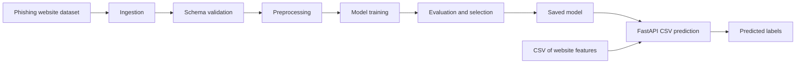

# PhishDetector

<div align="center">

### Machine learning for phishing website detection

Identify suspicious websites with a reusable phishing-classification model and a FastAPI prediction service.

[](https://www.python.org/)
[](https://fastapi.tiangolo.com/)
[](https://scikit-learn.org/)
[](https://www.docker.com/)
[](LICENSE)

</div>

PhishDetector brings together dataset validation, model training and evaluation, and prediction through a REST API. It includes an experimental URL-feature prediction module; the API itself currently accepts **CSV feature data**, not a URL string.

> **Use responsibly:** This project is a machine-learning demonstration, not a security guarantee. Never rely on a prediction alone to decide whether a website is safe.

## Contents

- [Highlights](#highlights)
- [How it works](#how-it-works)
- [Model results](#model-results)
- [Quick start](#quick-start)
- [API](#api)
- [Project layout](#project-layout)
- [URL prediction module](#url-prediction-module)
- [Docker](#docker)
- [Dataset and references](#dataset-and-references)

## Highlights

- Validates dataset columns and values against a YAML schema.
- Trains and compares five scikit-learn classifiers.
- Saves a trained model and pipeline evaluation reports.
- Serves schema and CSV prediction endpoints with FastAPI.
- Includes a separate URL feature extractor and prediction helper.

## How it works



The prediction API expects the model's website-feature columns. It does not fetch or inspect a website when given a URL.

## Model results

The checked-in evaluation report records these cross-validation results:

| Model | Mean CV score | Standard deviation | Mean fit time |
| --- | ---: | ---: | ---: |
| Random Forest | **97.12%** | 0.42% | 1.02 s |
| Support Vector Classifier | 96.29% | 0.64% | 5.04 s |
| K-Nearest Neighbors | 96.23% | 0.46% | 0.01 s |
| Logistic Regression | 92.70% | 0.47% | 0.10 s |
| Ridge Classifier | 92.06% | 0.53% | 0.01 s |

Random Forest is the highest-scoring model in that report. Results depend on the dataset and evaluation setup; retrain and validate the model before relying on it in another environment.

The saved evaluation report also records **97.65% accuracy**, **97.90% F1**, **97.35% precision**, and **98.46% recall**. These are reported experiment results, not a guarantee of performance on new websites.

## Quick start

### Requirements

- Python 3.10 or newer
- Git
- Docker (optional)

### 1. Clone and enter the repository

```bash
git clone https://github.com/10pateladitya/Phishing-Website-Detection.git
cd Phishing-Website-Detection
```

### 2. Create a virtual environment

**Windows PowerShell**

```powershell
py -m venv .venv
.\.venv\Scripts\Activate.ps1
```

**macOS / Linux**

```bash
python3 -m venv .venv
source .venv/bin/activate
```

### 3. Install the project and dependencies

```bash
python -m pip install --upgrade pip
python -m pip install -r requirements.txt
python -m pip install -e .
```

### 4. Start the API

```bash
uvicorn run_api:app --reload --host 127.0.0.1 --port 8000
```

Then visit [http://127.0.0.1:8000/docs](http://127.0.0.1:8000/docs) for interactive API documentation. The API loads the model from `artifacts/models/model.pkl` and the input schema from `data/schema.yaml` at startup.

## API

### `GET /api/v1/schema`

Returns the expected feature schema.

### `POST /api/v1/predict`

Upload a CSV file as the multipart form field `data`. The CSV must contain the feature columns expected by the trained model; omit the target column.

```bash
curl -X POST "http://127.0.0.1:8000/api/v1/predict" \
  -F "data=@data/test_input.csv;type=text/csv"
```

The response contains the predicted labels:

```json
{
  "predictions": [-1, 1, -1]
}
```

In this dataset, `1` represents phishing and `-1` represents legitimate. See the interactive docs for the live request schema and response.

## Project layout

```text
.
├── artifacts/
│   ├── feature_store/       # Ingested and validated datasets
│   ├── models/model.pkl     # Trained model used by the API
│   └── reports/             # Validation, training, and evaluation reports
├── data/
│   ├── phishingData.csv
│   ├── schema.yaml
│   └── test_input.csv
├── docs/
│   └── Phishing_Websites_Features.pdf
├── frontend/                # Frontend work in progress
├── src/phishdetector/
│   ├── api/                 # FastAPI routes
│   ├── components/          # Data and model pipeline components
│   ├── feature_extraction/  # URL feature extraction and prediction helper
│   └── pipelines/           # Training, preprocessing, and inference
├── tests/
├── Dockerfile
├── main.py
└── run_api.py
```

## URL prediction module

The repository also contains `URLPredictor`, a separate helper that accepts one URL and returns a prediction with its derived features. Its URL extractor calculates a limited set of URL-only features and fills the remaining model inputs with default values; it does not retrieve or inspect the website. Treat these predictions as experimental.

## Docker

Build and run the API from the repository root:

```bash
docker build -t phishdetector .
docker run --rm -p 8000:8000 phishdetector
```

Open [http://localhost:8000/docs](http://localhost:8000/docs) after the container starts.

## Dataset and references

- Dataset: [UCI Phishing Websites](https://archive.ics.uci.edu/dataset/327/phishing+websites)
- Feature descriptions: [`docs/Phishing_Websites_Features.pdf`](docs/Phishing_Websites_Features.pdf)
- Input schema: [`data/schema.yaml`](data/schema.yaml)
- License: [MIT](LICENSE)
