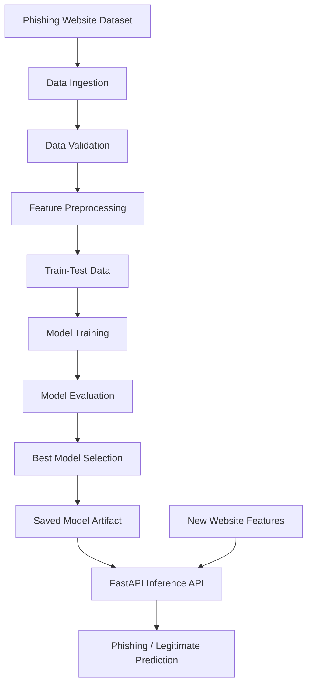

# PhishDetector
### Intelligent Phishing Website Detection | Machine Learning + FastAPI

**Identify suspicious websites. Analyze URL features. Make safer browsing decisions.**

PhishDetector is an end-to-end machine learning system designed to classify websites as phishing or legitimate using URL and website-related features. It brings together data ingestion, validation, preprocessing, model training, evaluation, and real-time inference in a modular Python application.

The project explores how traditional machine learning models can be integrated into a practical detection pipeline and exposed through a FastAPI service.

<p>
  
  
  
  
</p>

<p>
  
  
  
</p>

---

## 01 — The Problem

Phishing websites imitate legitimate websites to trick people into revealing passwords, financial information, and other sensitive data.

Detecting these websites automatically is challenging because malicious sites can use convincing domain names, deceptive URL structures, and other suspicious characteristics.

PhishDetector addresses this challenge by learning patterns from labelled website data and using those patterns to predict whether a website is likely to be phishing or legitimate.

**Project objectives**

- Build a structured data ingestion and validation pipeline.
- Prepare website features for machine learning.
- Compare multiple classification algorithms.
- Select and evaluate a high-performing model.
- Save trained model artifacts for reuse.
- Expose predictions through a FastAPI endpoint.
- Support reproducible execution and Docker-based deployment.

## 02 — How It Works



### Pipeline stages

| Stage | What happens |
|---|---|
| Data ingestion | Loads the source dataset and prepares input data. |
| Data validation | Checks data structure, schema, and expected features. |
| Preprocessing | Prepares feature values for model training and inference. |
| Model training | Trains multiple machine learning classifiers. |
| Model evaluation | Compares models using validation performance. |
| Model selection | Identifies the best-performing estimator. |
| Inference | Uses the saved model to predict on new feature inputs. |
| API serving | Exposes the prediction pipeline through FastAPI. |

## 03 — Dataset & Features

**Source:** UCI Machine Learning Repository — Phishing Websites Dataset.

| Attribute | Details |
|---|---|
| Dataset file | `data/raw/phishingData.csv` in the described configuration |
| Input features | 30 website-related attributes |
| Target column | `Result` |
| Phishing label | `1` |
| Legitimate label | `-1` |
| Feature documentation | `docs/Phishing_Websites_Features.pdf` |

The dataset contains structured attributes associated with website and URL characteristics, such as URL length, IP-address usage, and HTTPS-related indicators.

The feature documentation explains the meaning and derivation of the dataset's attributes.

**Important:** The model operates on the expected feature representation. It does not automatically verify a website's safety simply because a user supplies a URL string. URL parsing and feature extraction must be implemented correctly before raw URLs can be passed to the trained model.

## 04 — Model Comparison

The project evaluates five machine learning approaches to identify the strongest candidate for phishing detection.

| Model | Mean CV score | Standard deviation | Mean fit time |
|---|---:|---:|---:|
| Random Forest | 97.11% | 0.41% | 1.02 s |
| Support Vector Classifier | 96.29% | 0.64% | 5.03 s |
| K-Nearest Neighbors | 96.23% | 0.46% | 0.01 s |
| Logistic Regression | 92.70% | 0.47% | 0.10 s |
| Ridge Classifier | 92.06% | 0.53% | 0.01 s |

*These are the reported mean validation scores and fit times from the supplied project description. The exact metrics and timings should be confirmed by rerunning the training pipeline.*

### Selected model: Random Forest

Random Forest achieved the highest reported mean validation score of **97.11%**, making it the selected model in the documented experiment.

Its ensemble of decision trees can learn nonlinear relationships between website attributes without requiring the same feature scaling typically needed by some other algorithms.

### Training artifacts

The documented output files include:

- `artifacts/reports/evaluation_report.yaml`
- `artifacts/reports/training_report.yaml`
- `artifacts/reports/data_validation_report.yaml`
- `artifacts/models/model.pkl`

These artifacts help record the training process, validation results, and selected model.

## 05 — Technology Stack

| Technology | Purpose |
|---|---|
| Python 3.10+ | Application and pipeline logic |
| Pandas | Dataset handling |
| Scikit-learn | Classification and model evaluation |
| FastAPI | Prediction API |
| Uvicorn | ASGI application server |
| PyYAML | Configuration and report handling, where used |
| Docker | Containerized execution |

## 06 — Project Structure

```text
phishdetector/
│
├── Dockerfile
├── LICENSE
├── README.md
├── requirements.txt
├── setup.py
├── main.py
├── run_api.py
│
├── data/
│   ├── phishingData.csv
│   └── schema.yaml
│
├── docs/
│   └── Phishing_Websites_Features.pdf
│
├── notebooks/
│
├── artifacts/
│   ├── feature_store/
│   │   ├── ingested/
│   │   └── validated/
│   ├── models/
│   │   └── model.pkl
│   └── reports/
│       ├── data_validation_report.yaml
│       ├── evaluation_report.yaml
│       └── training_report.yaml
│
└── src/
    └── phishdetector/
        ├── api/
        │   └── v1/
        │       └── endpoints.py
        ├── components/
        │   ├── data_ingestion.py
        │   ├── data_validation.py
        │   ├── model_evaluation.py
        │   ├── model_prediction.py
        │   └── model_training.py
        ├── config/
        ├── entity/
        │   ├── artifact_entity.py
        │   └── config_entity.py
        ├── pipelines/
        │   ├── inference/
        │   ├── preprocessing/
        │   └── training/
        └── utils/
```

*This is a summarized view of the supplied structure. Adjust directory names and file paths to match your own repository.*

## 07 — Getting Started

### Prerequisites

- Python 3.10 or a compatible version
- Git
- pip
- Docker, if using containerized execution

### Step 1: Clone your repository

After creating the repository under your GitHub account:

```bash
git clone https://github.com/10pateladitya/phishdetector.git
cd phishdetector
```

Replace `phishdetector` if you choose a different repository name.

### Step 2: Create a virtual environment

**Windows PowerShell**

```powershell
python -m venv .venv
.venv\Scripts\Activate.ps1
```

**Linux / macOS**

```bash
python3 -m venv .venv
source .venv/bin/activate
```

### Step 3: Install dependencies

```bash
python -m pip install --upgrade pip
pip install -r requirements.txt
```

### Step 4: Start the API

From the project root, run:

```bash
uvicorn run_api:app --reload --host 127.0.0.1 --port 8000
```

The API should be accessible at:

- API root: http://127.0.0.1:8000
- Interactive documentation: http://127.0.0.1:8000/docs

The API startup assumes that the required configuration and model artifacts are available.

## 08 — API Usage

The documented prediction endpoint is:

`POST /api/v1/predict-url`

Example request:

```json
{
  "url": "https://example.com"
}
```

The request illustrates the URL-based interface. The actual response format and whether raw URLs are supported depend on the feature-extraction and prediction implementation.

A typical prediction response could communicate:

- The submitted URL.
- The predicted class.
- A human-readable classification.
- Extracted features or a confidence value, if implemented.

**Security note:** A phishing classifier is a decision-support tool, not a guarantee that a website is safe. Predictions depend on the training data, extracted features, and model limitations.

## 09 — Docker Deployment

Docker can package the API and its runtime dependencies into a consistent environment.

### Build the image

```bash
docker build -t phishdetector .
```

### Run the container

```bash
docker run --rm -p 8000:8000 phishdetector
```

Once running, open:

http://localhost:8000/docs

Ensure the Dockerfile starts Uvicorn on `0.0.0.0:8000` and includes any model artifacts or configuration files needed at runtime.

## 10 — Roadmap

- [x] Dataset ingestion and validation
- [x] Feature preprocessing
- [x] Model training and comparison
- [x] Model evaluation and artifact generation
- [x] FastAPI integration
- [ ] Build an interactive Streamlit frontend
- [ ] Add automated tests for the inference pipeline
- [ ] Introduce CI/CD using GitHub Actions
- [ ] Add model monitoring and drift detection
- [ ] Improve raw URL feature extraction and input validation
- [ ] Evaluate the model on additional phishing datasets

## 11 — What This Project Demonstrates

PhishDetector brings together several practical engineering concepts:

- End-to-end machine learning pipeline design.
- Schema-based dataset validation.
- Feature engineering for cybersecurity classification.
- Comparative evaluation of multiple ML algorithms.
- Reusable model serialization and inference.
- REST API development with FastAPI.
- Containerization and reproducible execution.
- Modular project organization for maintainability.

## About

**Aditya Patel**

GitHub: [@10pateladitya](https://github.com/10pateladitya)

PhishDetector is part of my hands-on exploration of machine learning, cybersecurity, and production-oriented Python applications.

---

<p align="center">
  <b>PhishDetector</b>
  <br/>
  <sub>Machine learning for smarter phishing detection.</sub>
</p>
# Phishing-Website-Detection

# Phishing-Website-Detection

